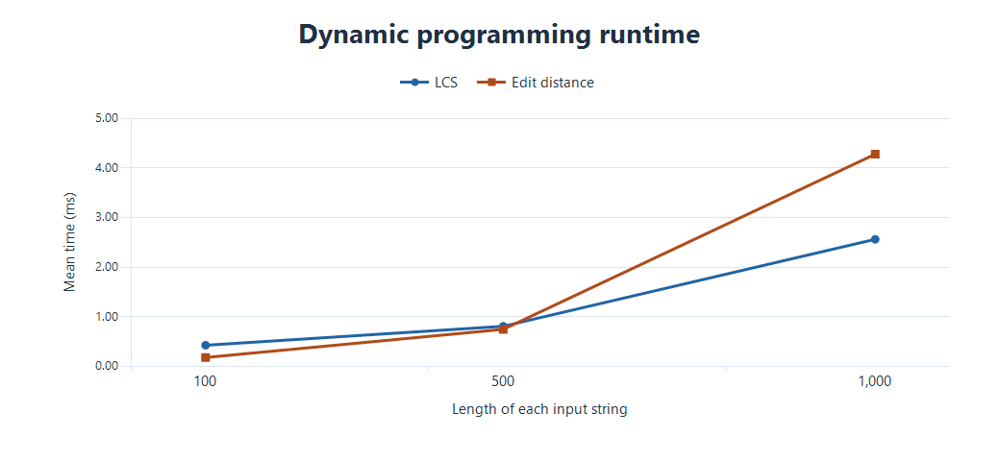
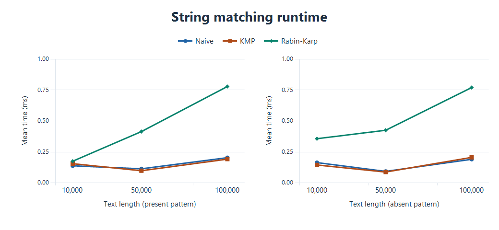

# Assignment 4 · Text Analysis

This Java project compares six algorithms for sequence similarity, exact substring search, and suffix analysis. LCS and Levenshtein distance compare two complete strings. Naive matching, KMP, and Rabin–Karp find every occurrence of a pattern. Kasai's algorithm computes common prefix lengths between adjacent sorted suffixes.

## Run

Use JDK 17 or later. The project has no external Java dependencies. From the repository root, compile in PowerShell with `javac -d out (Get-ChildItem src -Filter '*.java').FullName` or use the first command below in Bash. The two `java` commands work in either shell.

```sh
javac -d out src/*.java
java -cp out Main --test
java -cp out Main --benchmark
```

In IntelliJ IDEA, select a JDK, mark `src` as a Sources Root if needed, and run `Main.main`. Running with no arguments executes the tests and benchmark. A benchmark run writes a fresh CSV to `out/benchmark/measurements.csv`. The recorded CSV and PNG plots below are stored separately in `results/`.

Each algorithm has its own Java file. `MatchResult` holds occurrence indices and comparison counts. `AlgorithmTests` checks correctness, and `Benchmark` generates inputs and measures runtime.

## Algorithms and assumptions

Input strings are non-null and compared case-sensitively as sequences of Java UTF-16 code units. Indices are zero-based. All matchers return indices in ascending order and keep overlapping occurrences. An empty pattern matches all boundaries from `0` through the text length, including boundary `0` for an empty text. A pattern longer than the text has no matches.

**Longest common subsequence.** Let `L[i][j]` be the longest common subsequence length of the first `i` and `j` code units. The empty prefix row and column are zero. If the last code units are equal, an optimal subsequence can end with that common code unit, so the result is `L[i-1][j-1] + 1`. If the last code units differ, at least one must be left out, so the result is `max(L[i-1][j], L[i][j-1])`. A subsequence can skip code units.

**Levenshtein distance.** Let `D[i][j]` be the minimum edit cost between the first `i` and `j` code units. The base cases are `D[i][0] = i` deletions and `D[0][j] = j` insertions. The last step of a prefix alignment is a deletion, insertion, or a diagonal match or substitution. Take the minimum of `D[i-1][j] + 1`, `D[i][j-1] + 1`, and `D[i-1][j-1] + cost`, with `cost = 0` for equal code units and `1` otherwise. Each candidate is attainable from a smaller prefix problem.

**Naive matching.** Check every legal starting offset and stop the comparison at the first mismatch within each window.

**Knuth–Morris–Pratt.** The LPS table stores the longest proper prefix of each pattern prefix that is also its suffix. After a mismatch, the next candidate prefix length comes from this table. The matched suffix is already known, so the text index never moves backwards. After a match, use the same fallback to retain overlapping matches.

**Rabin–Karp.** A polynomial hash with base 257 and modulus 1,000,000,007 represents the pattern and current window. Remove the outgoing contribution, multiply by the base, and add the incoming code unit to slide the window in constant time. When hashes agree, compare code units to verify the candidate. This rejects false matches from collisions.

**Kasai LCP.** Given a suffix array `SA` sorted in lexicographic order, `LCP[i]` is the length of the shared prefix of suffixes starting at `SA[i-1]` and `SA[i]`, with `LCP[0] = 0` for nonempty text. The method assumes a valid suffix array containing every starting index once. Inverse ranks locate each suffix's predecessor. If the current suffix and its predecessor share `h > 0` code units, removing the first code unit from both leaves `h-1` shared units. When that lower bound is positive, the shifted predecessor still sorts before the shifted suffix. Every suffix between them shares the same prefix, so the new predecessor can start its comparison at that lower bound.

## Theoretical complexity

For dynamic programming, `m` and `n` are the two string lengths. For matching, `n` is text length, `m` is pattern length, and `w = n-m+1` is the number of windows when `1 <= m <= n`. Auxiliary space excludes returned results. The match list itself uses O(k) space for k occurrences.

| Algorithm | Main operation | Preprocessing | Best time | Worst time | Auxiliary space | Justification |
|---|---|---:|---:|---:|---:|---|
| LCS | Diagonal + 1 or max of top and left | O(1) | O((m+1)(n+1)) | O((m+1)(n+1)) | O((m+1)(n+1)) | Allocate and fill a full table, with constant work per cell. |
| Levenshtein | Minimum of insert, delete, and match or substitute | O(1) | O((m+1)(n+1)) | O((m+1)(n+1)) | O((m+1)(n+1)) | The full table includes the initialized first row and column. |
| Naive | Compare each window from its start | O(1) | O(w) search | O(wm) search | O(1) | Each window can fail on its first comparison or require all m. |
| KMP | Follow LPS links on a mismatch | O(m) | O(n) search | O(n) search | O(m) | Each fallback reduces the matched length, which can grow only as the scan advances. |
| Rabin–Karp | Roll the hash and verify hash hits | O(m) | O(w) search | O(wm) search | O(1) | Every window costs one hash update, and every hash hit can cost up to m comparisons. |
| Kasai | Find predecessor by rank and reuse the common prefix | O(n) inverse ranks | O(n) total | O(n) total | O(n) | The prefix length is carried forward and decreases by at most one per step when positive. Its total increases and the outer scan are linear. |

For nonempty DP inputs the table cost is O(mn) in both time and space. Empty patterns take O(n+1) time to produce their indices. Patterns longer than the text return in O(1) time. Rabin–Karp runs in near-linear expected time on inputs with few hash hits under a well-distributed hash assumption. Its search can cost O(w + hm) when h windows share the pattern hash, including true matches. Repetitive or adversarial inputs can make h as large as w. KMP guarantees linear preprocessing plus search even in that case.

## Correctness tests

The test suite passed **46 assertions**. LCS checks identical, disjoint, empty, and noncontiguous inputs. Levenshtein checks identical inputs, an empty string in either position, the three individual edit types, and a mixed case. For every matching case, Naive is checked against an expected list, and KMP and Rabin–Karp are each checked against Naive. Cases include the beginning, middle, end, multiple and overlapping occurrences, absence, a longer pattern, empty inputs, and a deliberate hash collision.

For `banana`, the sorted suffixes are `a`, `ana`, `anana`, `banana`, `na`, and `nana`. The manually verified suffix array is `[5, 3, 1, 0, 4, 2]` and the expected LCP array is `[0, 1, 3, 0, 0, 2]`. The tests also cover repeated code units, empty input, and one code unit.

## Experiment setup

A single `Random(42)` generates strings from the lowercase English alphabet `abcdefghijklmnopqrstuvwxyz`. For each DP size, both algorithms use the same pair of independently generated strings. Each matching text has a 32-code-unit present pattern copied from its midpoint and a 32-code-unit random pattern verified to be absent. Each of the three matchers receives the same text and pattern for a given comparison. For Kasai, a helper sorts suffix starts before the timed runs.

Each workload uses 25 untimed warm-up calls followed by five measured calls. The reported time is the arithmetic mean in milliseconds from `System.nanoTime()`. Measurements include algorithm preprocessing, result allocation, and the matching counters. Input generation, suffix sorting, correctness checks, console output, and file output are outside the measured region. Counts include direct code-unit comparisons, including mismatches. Rabin–Karp hash operations are separate from direct comparisons.

The recorded run used OpenJDK 25.0.1 on Windows with an Intel Core i5-12450H. The full data is in [measurements.csv](results/measurements.csv).

## Results

### Dynamic programming

The cell count is the number of non-base cells updated per algorithm.

| Length of each string | Cells updated | LCS length | LCS mean (ms) | Edit distance | Edit mean (ms) |
|---:|---:|---:|---:|---:|---:|
| 100 | 10,000 | 28 | 0.431840 | 93 | 0.184940 |
| 500 | 250,000 | 159 | 0.813900 | 439 | 0.751880 |
| 1,000 | 1,000,000 | 315 | 2.566540 | 889 | 4.280700 |



### String matching

KMP comparison counts are shown as preprocessing / search. Naive and Rabin–Karp make zero preprocessing character comparisons. Rabin–Karp still spends time computing the initial hashes.

| Pattern | Text length | Matches | Naive (ms) | KMP (ms) | Rabin–Karp (ms) | Naive comparisons | KMP comparisons | Rabin–Karp comparisons |
|---|---:|---:|---:|---:|---:|---:|---:|---:|
| Present | 10,000 | 1 | 0.138680 | 0.155640 | 0.175260 | 10,388 | 33 / 10,369 | 32 |
| Present | 50,000 | 1 | 0.114200 | 0.098660 | 0.414920 | 52,002 | 31 / 51,914 | 32 |
| Present | 100,000 | 1 | 0.204100 | 0.192240 | 0.778880 | 104,052 | 33 / 103,899 | 32 |
| Absent | 10,000 | 0 | 0.164360 | 0.145060 | 0.357320 | 10,388 | 33 / 10,398 | 0 |
| Absent | 50,000 | 0 | 0.093500 | 0.088100 | 0.425580 | 51,980 | 31 / 51,926 | 0 |
| Absent | 100,000 | 0 | 0.191000 | 0.206480 | 0.770460 | 103,987 | 34 / 103,861 | 0 |



### Kasai

| Text length | Mean (ms) | Maximum LCP |
|---:|---:|---:|
| 1,000 | 0.072400 | 4 |
| 5,000 | 0.136600 | 5 |
| 10,000 | 0.132500 | 5 |

## Discussion and conclusion

Doubling the DP input length from 500 to 1,000 quadrupled the number of updated cells. Mean times increased about 3.15× for LCS and 5.69× for edit distance. The difference from 4× reflects the limits of a five-run wall-clock sample, where JVM compilation, allocation, and scheduling affect timing. Both methods still use quadratic table space on equal-length inputs. LCS measures ordered similarity, while edit distance measures the work of transforming one string into the other.

Naive matching often stopped on the first code unit, so its direct comparison count was close to KMP's on these random inputs. At 100,000 code units, both took around 0.2 ms in either case. Rabin–Karp made only 32 direct comparisons with a present pattern and zero with an absent one, yet took around 0.77 ms because every window still required modular arithmetic. The Naive implementation is compact and competitive on these workloads. KMP provides a worst-case guarantee with an O(m) table. Rabin–Karp uses constant auxiliary space but its verification cost depends on the number of hash hits.

Kasai took about 0.13 ms at both 5,000 and 10,000 code units. These short measurements do not establish the growth rate. The linear bound follows from reuse of the common prefix and applies once the sorted suffix array is available.